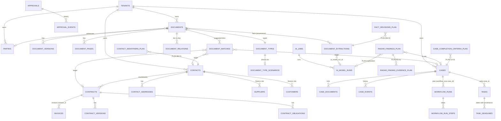

# ER-диаграмма: основные сущности

Показаны существующие сущности (из миграций V1–V45) и планируемые добавки. Таблицы и столбцы названы так, как в миграциях; планируемые помечены `PLAN`.

Правила: новые таблицы — только перечисленные с суффиксом `_PLAN`; универсальных связей «любой-с-любым» нет (D-02).
