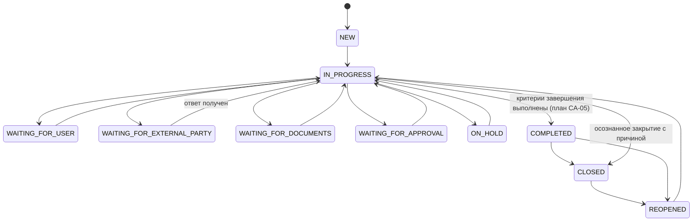
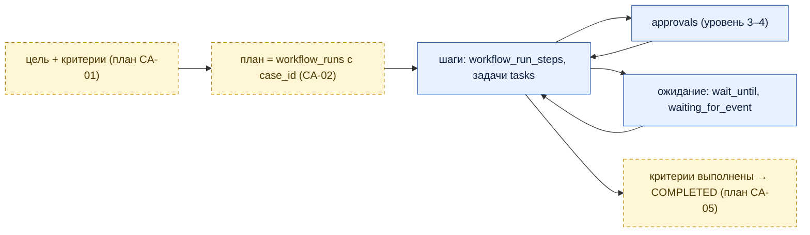

# Жизненный цикл дела

Статусы канонические (`cases_status_chk`, `V4__cases_and_contacts.sql`). Допустимые переходы заданы в `cases/domain/CaseStatusMachine` и проверены `CaseLifecycleTest`; диаграмма показывает основные из них (полный граф — в коде).

Соответствие терминам ТЗ v2.0: OPEN = NEW; WAITING_FOR_EXTERNAL_RESPONSE = WAITING_FOR_EXTERNAL_PARTY; BLOCKED = ON_HOLD; CANCELLED = CLOSED + `close_reason=CANCELLED` (D-03).

