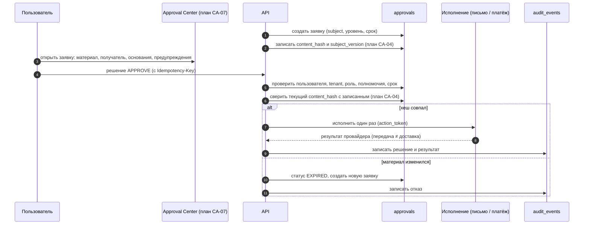

# Подтверждение значимого действия

Существует: заявка, решение, идемпотентность по `action_token`, срок `expires_at`, аудит (`approvals`, `approval_events`). Планируется: привязка к содержимому (D-09, CA-04).

